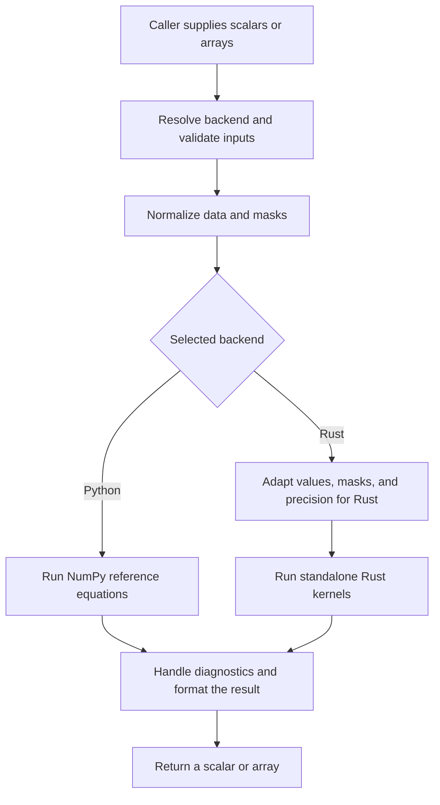
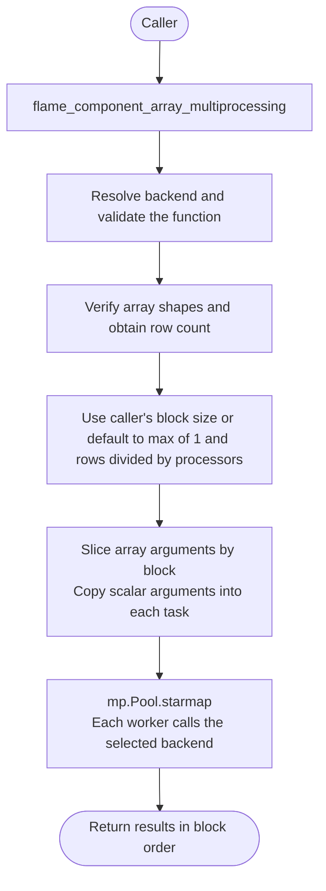

# Flame Components ? Codebase Reference

## Architecture Overview

Flame Components has a Python facade, a standalone Rust library, and a
standalone CLI for wildfire flame-behavior calculations. The six Python
calculations accept real scalars and numeric NumPy arrays, including masked
arrays. A separate dispatcher partitions arrays by row for multiprocessing.

The Python facade validates inputs and selects a backend. NumPy provides the
Python reference equations. The compiled Python extension adapts NumPy
buffers to the standalone Rust library. Automatic selection prefers Rust
when the extension loads and uses NumPy when the extension is absent or a
caller requests explicit NumPy error handling. Import errors in an installed
extension propagate to the caller.

The Rust library and CLI build independently of Python. The library's
optional `extended` feature bundles the host C `long double` arithmetic used
by the Python extension for compatible extended-precision inputs. Maturin
builds the Python distribution from the workspace version in `rust/Cargo.toml`.
The Python package reads its installed version through `importlib.metadata`.

The ArcPy implementation under `archive/` is a historical reference.

## Key Files and Responsibilities

| File | Role |
|---|---|
| `src/flame_components/core.py` | Public signatures, model validation, result formatting, and warnings. |
| `src/flame_components/_backend.py` | Backend selection and native extension loading. |
| `src/flame_components/_equations.py` | NumPy reference equations and model coefficients. |
| `src/flame_components/_native_bridge.py` and `_precision.py` | Native buffers, masks, shapes, and NumPy-compatible precision metadata. |
| `src/flame_components/_utils.py` | Shared validation, masking, and result formatting. |
| `src/flame_components/_blocks.py` | Block partitioning and module-level multiprocessing worker. |
| `src/flame_components/__init__.py` | Public API exports and installed version. |
| `rust/crates/flame-components/` | Rust equations, typed scalar and array APIs, and optional extended arithmetic. |
| `rust/crates/flame-components-py/` | PyO3 and NumPy buffer bindings. |
| `rust/crates/flame-components-cli/` | Standalone scalar CLI with flags and JSON input. |
| `tests/fixtures/parity/` | Frozen Python reference inputs, outputs, and provenance. |
| `docs/TEST_SUITE_DESCRIPTION.md` | Test suites and verification commands. |
| `README.md` | Installation, usage, API reference, and scientific sources. |

### `core.py` — function inventory

| Function | Inputs | Output | Source |
|---|---|---|---|
| `get_mid_flame_ws` | wind speed, canopy cover, canopy ht, canopy base ht, units | mid-flame wind speed (m/s) | Albini & Baughman (1979) |
| `get_flame_length` | model name, fire intensity, [flame depth], [params_only] | flame length (m) or model coefficients | 29 published models; catalogued from Finney & Grumstrup (2023) |
| `get_flame_height` | model name, flame length + model-specific params | flame height (m) | Nelson & Adkins (1986) or Finney & Martin (1992) |
| `get_flame_tilt` | model name + model-specific params | tilt angle from vertical (degrees) | Standard geometry, Finney & Martin (1992), Butler et al. (2004) |
| `get_flame_residence_time` | ROS, fuel consumption, mid-flame WS, units | residence time (sec or min) | Nelson & Adkins (1988) |
| `get_flame_depth` | ROS, residence time | flame depth (m) | Fons et al. (1963) |
| `flame_component_array_multiprocessing` | flame_function name, num_processors, block_size, **kwargs | List of results in block order | Internal dispatcher over the above |

Public Python function names use snake_case.

---

## Data Flow

### Single-function call

### Multiprocessing path

---

## Implicit Assumptions and Gotchas

These are real behaviors of the current code, not historical bugs — several are also
asserted directly by the test suite (see `docs/TEST_SUITE_DESCRIPTION.md`).

### Unit handling
- `get_mid_flame_ws` **always returns m/s** regardless of input units. All internal
  geometry is done in feet (the Albini & Baughman equation is defined in US customary
  units); SI inputs are converted to feet, then the result is converted to m/s.
- `get_flame_residence_time`'s `ros` input must always be **m/min**; the `units` param
  only controls whether the *output* is seconds or minutes — it does not change the
  expected input unit.
- Wind-speed reference height differs between functions and is **not interchangeable**:
  - `get_mid_flame_ws` expects **10-m wind** (SI) or **20-ft wind** (IMP).
  - `get_flame_tilt`'s Butler model expects **10-m wind** measured above open ground or
    canopy top, using its own unit-conversion path (`kph`/`mps`/`mph`).
  Passing the output of one into the other's wind-speed input will silently produce a
  wrong result — there is no cross-check between them.

### Model-specific required params are checked at call time, not statically
`get_flame_height` and `get_flame_tilt` accept `Optional` params that become required
depending on `model`; missing required params raise `ValueError`, but a type checker or
IDE cannot catch this at write time since the signature alone allows `None`.

### `flame_component_array_multiprocessing` returns per-block results
The dispatcher keeps all rows, including any final partial block, and returns its results
in block order. Use `numpy.concatenate(results)` to join numeric result arrays. Flame
length with `params_only=True` returns one coefficient tuple per block.

### `canopy_ht == 0` guard in `get_mid_flame_ws`
Zero canopy heights are replaced with `0.5 * 3.28084` ft (≈0.5 m) to avoid
division-by-zero in the log term, and a `UserWarning` is raised. This is a silent
substitution — callers with legitimately open (no-canopy) sites should be aware their
`canopy_ht` input is altered before the calculation runs.

### Missing values and result dtypes
`_utils.numeric_array` combines input NaNs with any existing mask. Masked-array
operations can store internal fill values at masked positions, so
`_utils.nonnegative_result` writes NaN at each masked position. It preserves computed
NaNs, signed zero, and the computed dtype. An integer or boolean result is promoted to
floating point when a masked position requires NaN.

### Scalar and array results
If all inputs are scalars, the calculation returns a NumPy scalar from a one-element
internal array. Passing any `ndarray` returns an array. Flame depth multiplication uses
NumPy dtype rules, including fixed-width integer overflow before the nonnegative clamp.

### `get_flame_length`'s `params_only=True`
Returns the raw tuple of model coefficients rather than a computed value. Useful for
introspection but the return type changes (`tuple` vs. `float`/`ndarray`) — callers must
guard against this rather than assuming a numeric return.

### Two deliberately different failure modes for bad input
- **Type/argument errors** (wrong type, missing required argument, unknown `model`/`units`
  string) raise `TypeError`/`ValueError` immediately.
- **Numerically degenerate but validly-typed input** (division by zero, an `arccos`
  argument outside `[-1, 1]`) returns `NaN`, consistent with the NaN-propagation contract
  above — this is intentional, not a gap. See `docs/TEST_SUITE_DESCRIPTION.md`'s
  "Documented NaN-for-undefined behaviors" for the exact list.
